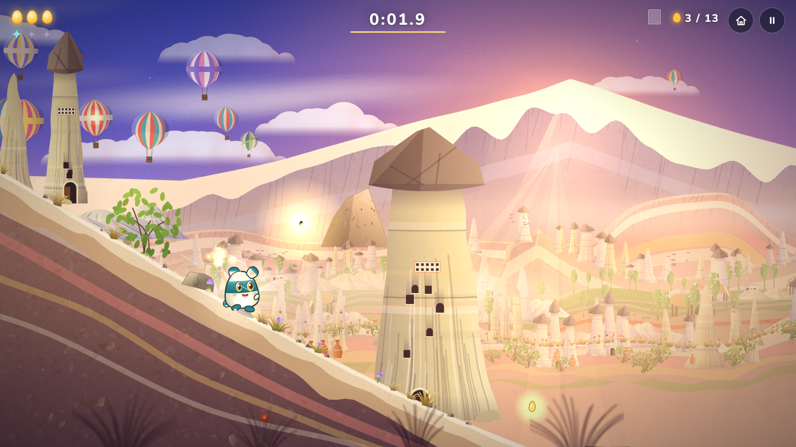
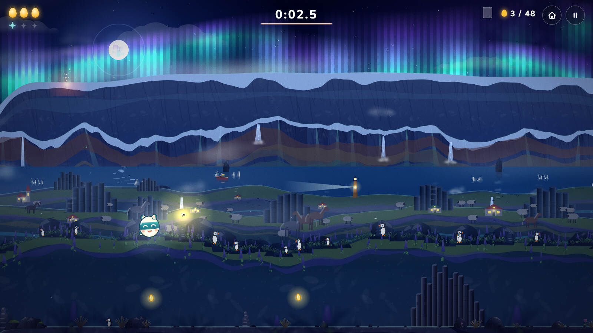
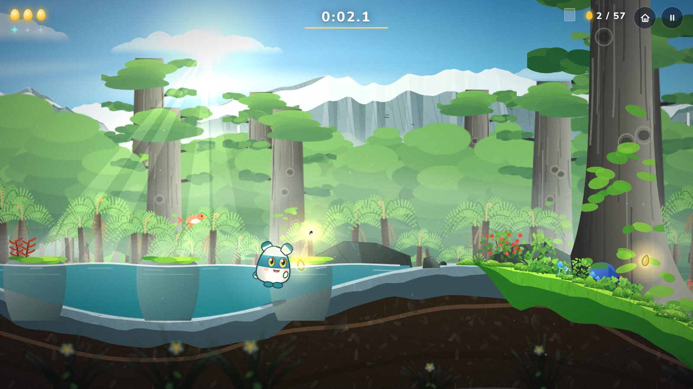

# Gradient Descent

A browser platformer about how machines learn.

Theta finds a seed of light that will grow only in the lowest valley in the world, and carries it downhill through seven countries to find that valley. Height is the loss, the slope underfoot is the gradient, and every level ends on the lowest ground there is. Every idea in it is one that is used to train real models.

**Play it:** https://www.gradientdescentgame.net

## The seven countries

| | Country | What it teaches |
|---|---|---|
| 1 | Cappadocia | Loss, the gradient, the learning rate, overshooting |
| 2 | Iceland | Momentum, local minima, where you start |
| 3 | Galápagos | Stochastic gradient descent: batches and noise |
| 4 | Namib | Plateaus and learning-rate schedules |
| 5 | Zhangjiajie | Ravines, and a step for each direction: AdaGrad, RMSProp, Adam |
| 6 | Patagonia | Backpropagation, exploding and vanishing gradients, clipping, skip connections |
| 7 | New Zealand | Generalising, overfitting, validation, early stopping, dropout |

Each country has five levels and a harder last one, a page of the notebook for every level, and six stamps to find. There is a short tutorial, a story, and a lab, on the title menu, in which Theta walks down a hill alone by the real rule of gradient descent. Under "More", once the first level is finished, there are a valley of the day, a long descent, a sorting game about precision and recall, a hidden valley and a wardrobe. T or Home goes back to the title screen from anywhere.

## For teachers

- `?teachers` lists every level, the idea it shows, and a question worth asking a class afterwards.
- `?class` opens the whole game with everything unlocked and nothing saved, so a class cannot write over anyone's progress.
- `?class&level=3-2` opens one level by its own address, to put on a slide. `?class&lab` opens the lab.

## Running it

The game is a static site: no build step, no server code, and no network calls while it is played. Everything is in `dist/`. Serve that folder with any static file server, for example

    python3 -m http.server -d dist 8000

and open http://localhost:8000. Progress is kept in the browser's own storage.

## Checks

    node --test tests/*.test.mjs     # the physics, every level, every stamp, the lab's rule
    node scripts/bot.mjs             # a scripted player runs every level and reports its times

`docs/DEVELOPMENT.md` has the house rules and the notes on how the game is put together.

## Credits

Created by Cantay Caliskan. He teaches data science and artificial intelligence, and studies politics and society with computational methods. https://www.cantaycaliskan.net/

Typefaces: Fredoka and Nunito, under the SIL Open Font Licence (the licences are in `dist/fonts/`). All pictures are drawn by the program, and all sound is made in the browser.

Also play this! [The Society Atlas](https://thesocietyatlas.net/) and [The Missing Variable](https://cantayus.github.io/the-missing-variable/).
